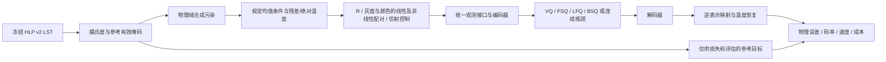

# LST 离散表征与图像复原实验框架

> 唯一实验依据为 [最终设计 v2](FINAL_PLAN_V2_ZH.md) 和 [88组逻辑清单](../lst_restoration_final_v2_20260927/manifest.json)：前25组诊断、主体76组、扩展12组。清单关闭执行，缺失入口仍须先接通。

**本版目标：在明确的温度侧信息和观测支持条件下，用紧凑离散表征恢复受传感器噪声、随机缺失和云形遮盖污染的 LST，并比较质量、码率与计算成本。**

下游分类、分割、生成模型、token 预测器均不属于本轮。当前先做 HLP 的 LST；HLS 沿用项目读取器，但本运行器尚未实现多波段实验，不能把 LST 温度扰动直接套到反射率。

## 当前状态

六主表与四补表的当前范围见 [表格索引](../../../TABLES.md)。尚未生成验证选择后逐行填表文件，不把设计清单当成运行配置。

- 已有数据、表示、污染、量化器、模型适配、损失、断点训练、完整评估、码流、报告和预检基础代码；这些接口尚未全部满足最新版设计。
- 尚须接入G_power/G_asinh、真正无均温、SD同架构scratch、Cosmos可训练适配、val-only阶段评估、选择冻结和汇总；主比较RGB辅助项为0也须落实。
- 已进行源码审阅、Python 语法和配置注册检查；2026-09-27 按用户要求补做了纯 CPU 的合成数值颜色映射往返与自动微分检查。**没有执行数据数值预检、模型初始化、模型前向/反向、训练、评估、GPU 测速或权重下载。**
- 所有生成配置均为 `execution.enabled=false`。这是遵守用户“先不要跑”的本次执行状态；不是另起一轮训练。
- 模型运行正确性、实测参数量/显存、模型输出颜色的逆映射梯度和真实数据接口仍待数值验收。独立映射的局部梯度已检查，不能替代模型验收。SatMAE++ 两尺度适配源码已接入、运行未验证；官方预训练模型仅接受可验证的本地权重。
- 历史目录及已有监督进程不在此框架控制范围；本轮不改写或重启历史实验。

## 数据流

新增幂变换/asinh 与共同分段颜色路径的公式、实测映射误差和适用限制见 [COLOUR_MAPPING_ZH.md](COLOUR_MAPPING_ZH.md)。这是合成标量检查，不是 HLP 重建结果。



编码器不接收目标温度、干净残差或隐藏的合成噪声支持。完整参考均值仅在预先声明的 oracle 条件下作为共同的一个 float32 标量提供；visible 对照只从带噪可见观测计算均值。

## 模型接入

2026-09-27 更新：新增地理模型使用网络框架从零训练，不进行 DEM/NDVI 权重迁移。详细适配和未完成门槛见 [GEO_BASELINES_ZH.md](GEO_BASELINES_ZH.md)。

|类型|本版实现|比较方式与限制|
|---|---|---|
|离散主线|VQ、FSQ、LFQ、BSQ|同 VAR 风格卷积骨干，默认 16×16 索引网格、1024 状态；公式适配，不宣称复现每篇论文全配方|
|暂缓|连续 AE、VAR 多尺度|已移出本轮配置计划，保留历史实现|
|新增地理 VAE|EO-VAE-LST|从零训练，固定 1/3 通道，连续 Gaussian 瓶颈；不使用光学预训练权重|
|新增地理离散模型|TerraMind-FSQ-LST|从零训练，1024 状态、16×16 索引；保留扩散解码，完整采样成本单列|
|地球空间结构|Prithvi 二维 MAE|真实 visible-token dropping/mask-token 解码，无时间输入；从零训练；复原目标适配|
|地球空间多尺度 MAE|SatMAE++-LST|128→256两尺度重建、从零训练；patch16独立对照，运行待验收|
|自然图像预训练|SD、SDXL、FLUX.1 KL-VAE|零微调与全部参数微调；SD同架构scratch待实现；SD/SDXL 不当成独立架构创新|
|自然图像离散预训练|Cosmos DI8×8 FSQ tokenizer|保留官方原生结构；同架构scratch/finetune对照；尚未接入|

FLUX.1 入口仅支持已核实的 diffusers AutoencoderKL 转换目录，不能直接把原始 `ae.safetensors` 塞进其他架构。参数与载荷均在模型审计时实测；尚未宣称这些模型已参数对齐。机制来源和适配区别见 [model_sources.md](model_sources.md)。

## 条件与对照

核心保留三种训练条件：完全不施加人工污染、10% 随机有效像素缺失、等概率混合污染。混合在每次记录呈现时只分配一种条件，实际类别计数入日志，不把六种污染变成六倍 epoch。

评估覆盖 clean、pixel10、Gaussian、条带、云形缺失、区域偏差、联合污染，以及预先列出的更强 Gaussian/30% 云形遮盖。`cloud_bias` 留作未用于混合训练的压力条件。整块 16×16 MAE 补全另列，不与 10% 像素遮盖混成同一任务。

实验顺序、配置数量和条件覆盖统一由 [最终设计](FINAL_PLAN_V2_ZH.md) 定义，不根据表格位置重复训练。完整88组为上限，颜色及跨架构扩展须满足预声明规则。

## 使用入口

以下只生成设计或查看命令，不加载 torch、数据或模型。在仓库根目录执行：

```bash
python tools/build_lst_final_design.py --output output/my_final_design/manifest.json
python -m experiments.paper1.lst_restoration --help
```

运行器接收未来完成验收的具体配置；当前符号化设计清单不能传给 `validate`、`train` 或 `run`。

未来恢复执行后，`preflight --part components|data-budget|model|all` 才会进行数值、数据或模型检查；**它会做优化器更新的合成技术测试，当前没有运行。**

```powershell
# 以下仅为未来调用说明：当前不要执行。
.venv-paper1/Scripts/python.exe -X utf8 -m experiments.paper1.lst_restoration preflight --config <config.json> --part all --device cuda:0 --output <audit-directory>
.venv-paper1/Scripts/python.exe -X utf8 -m experiments.paper1.lst_restoration assemble-preflight --config <config.json> --reports <components.json> <data_budget.json> <model.json> --output <preflight.json>
```

预检摘要绑定配置（排除执行开关）、所有实际本地源码和依赖指纹。改变表示、微批、模型或代码后旧预检不能自动通过。预检通过后仍须先落实v2阶段调度：当前 `run` 会一起进行val/test评估，不符合表示选择阶段的val-only要求，须改造后才可用于本轮。全部具体配置继续关闭执行。

核心还要用 `alignment-audit --reports <四个量化器的model.json> --output <alignment.json>` 核对实测参数差异≤5%、同通道及索引载荷，再把报告路径写入 `execution.alignment_report`。这与单模型“参数数目自洽”检查不同，不能拿旧架构数值跳过。

`train`、`evaluate --checkpoint <last.pt|pretrained>` 也可分开调用。`report --job ...` 只读结果；`gallery --cell ...` 只渲染已存预测；`compare --a ... --b ... --output ...` 要求物理输入一致；`token-stability` 则只接受同一模型权重的不同污染条件。

本版不启动后台 supervisor，不自动调度所有候选作业。输出目录 OS 锁、STOP、断点指纹防止重复或误续训。模型权重依赖缺失会明确报错，运行器不会自动下载。

## 完整性与可复现

- HLP v2 固定 218,975 / 11,684 / 11,757；摄氏度只能先反归一化再除以 100。
- 每模型 5 个完整 epoch、1,094,875 次记录呈现；有效 batch64，共 17,110 更新，每轮末次31条，不丢弃/补齐尾批。
- 核心微批固定4，LFQ/BSQ 的 batch 熵基于4幅图的256个 token。梯度累积并不把非线性 batch 熵变成 batch64 熵。
- 选用最后完整epoch；阶段选择仅用完整val，冻结比较范围后评估完整test。两个视图保留同一record/tile身份。
- 同条件跨组核对物理观测、目标和掩码摘要；均值摘要仅同均值协议比较，编码摘要仅同表示比较。
- 正式报告区分 raw / 共同范围投影、部分 / 最终结果；图片必须另行查看，生成 PNG 不会自动标记“视觉已复核”。
- 作业成本日志只追加。异常退出后未存盘的重算仍计成本，下界不包含停机空档；共享作业时长不能相加当物理单卡 GPU-hours。

断点预检目前通过复用正式 train_update 的 CPU 小模型设计验证，尚未执行；它本身也不能证明完整VAE在CUDA/AMP下的逐位续训等价。实际模型与硬件验收结果应如实单列。

详细科研口径与污染/统计细则见 [最终设计](FINAL_PLAN_V2_ZH.md)。静态检查不会替代数值与资源验收。

SatMAE++最新接入细节见 [SATMAE_LST_ZH.md](SATMAE_LST_ZH.md)：保留两尺度结构和MSE/L1监督形式，明确LST有效区域适配及与Prithvi的输入/损失差别。
